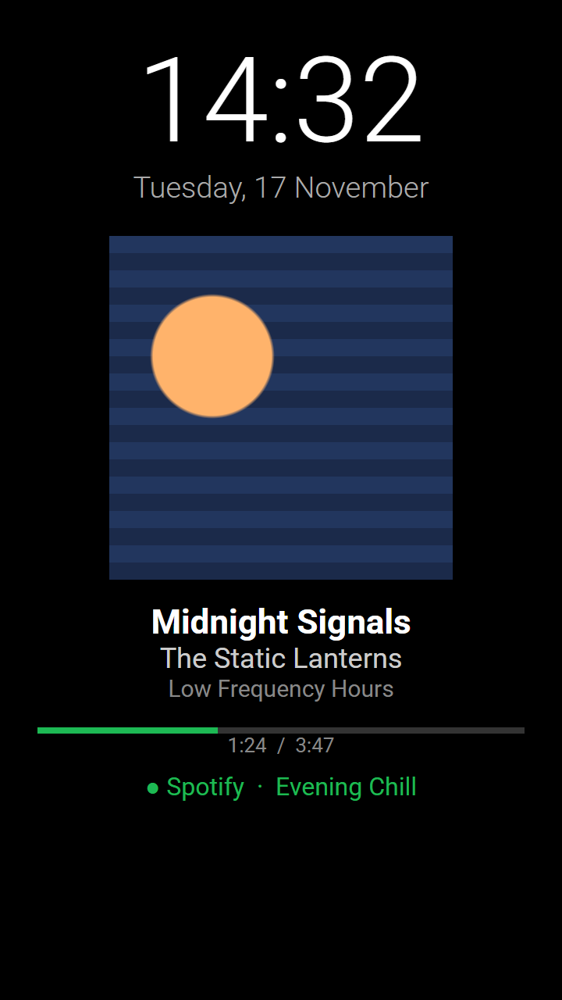
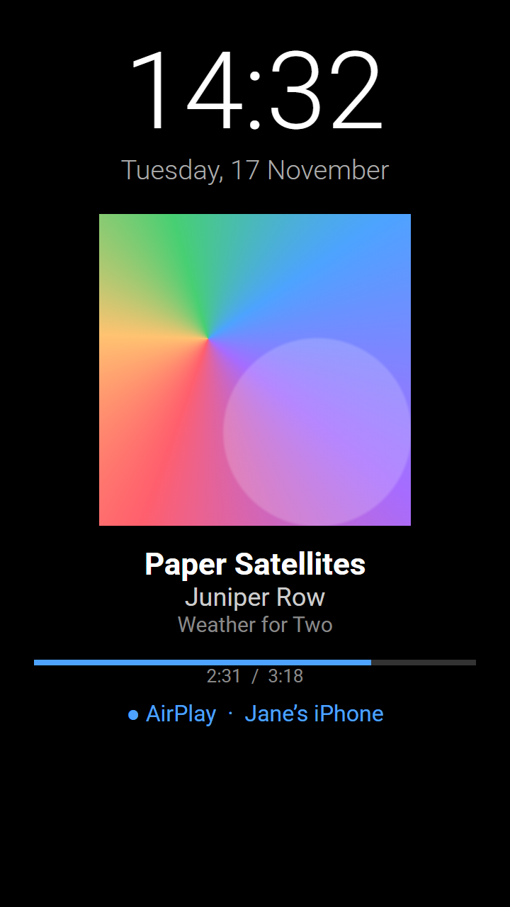

# old-android-speaker — AirPlay + Spotify Connect on an old Android 4.x phone

Turns an old Android phone (here: a **THL W200**, MediaTek MT6589, Android 4.2.1, kernel 3.4, broken
touchscreen) into a network speaker: plug a speaker into the 3.5 mm jack and it shows up as **W200**

- in the **AirPlay** list on iPhone/iPad/Mac (shairport-sync, classic AirPlay 1 audio),
- in **Spotify Connect** (Spotify's official headless client *Soloist*, needs Spotify Premium),

with a lock-screen style **"now playing" home screen** (clock, cover art, title/artist/album,
progress, source). Everything is driven over ADB from a PC; no Android SDK and no app store needed.

<p align="center">
  
  
  
  <br><sub>Home screen: idle, Spotify Connect, AirPlay (renders of the launcher layout with made-up tracks and cover art)</sub>
</p>

## Requirements
- A 32-bit ARM (ARMv7, hard-float) Android 4.x phone with **USB debugging** enabled.
  Tested only on the THL W200; other Android 4.x phones should work with small changes (see below).
- **Root** (SuperSU or similar) only for autostart on boot; everything else runs as the ADB shell user.
- A PC with ADB. The control/deploy scripts are **PowerShell (Windows)**; the build runs in
  **Linux / WSL** (Ubuntu 24.04 tested) and downloads its own toolchains (Rust, Zig, OpenJDK, D8).
- Spotify Connect: a **Spotify Premium** account and a **Soloist API key** from the Spotify for
  Developers dashboard (see "Spotify Connect (Soloist)").

## What's specific to the W200 / Android 4.2 (adjust for other phones)
| Item | Where | Notes |
|---|---|---|
| CPU tuning `cortex_a7` | `scripts/env.sh` (`W200_CPU`) | Use `cortex_a9` (or `cortex_a8`) for older ARMv7 SoCs, otherwise binaries can die with SIGILL. |
| Android 4.x layout: `/data/local/tmp`, `/sdcard`, `app_process` + `ANDROID_DATA` trick | `phone/*.sh` | Fine on 4.x; Android 5+ (SELinux, scoped storage) would need rework. |
| DNS file `/sdcard/w200.dns` | `scripts/06-fixes.sh`, `scripts/12c-soloist-stage.sh` | Binary patch of the 16-byte string `/etc/resolv.conf` — the replacement must stay exactly 16 bytes. |
| Wi-Fi interface `wlan0` | `phone/shairport-sync.conf` | Check with `adb shell netcfg`. |
| Shell user's groups | `helper/asshell.c` | Copied from `adb shell id` on Android 4.2. |
| Boot hook `/system/etc/install-recovery.sh` (init service `flash_recovery`) | `phone/system/`, `phone/install-autostart.sh` | Present on many old ROMs; check your `init.rc`. Refuses to overwrite an existing file. |
| Kernel 3.4 quirks (no `SO_REUSEPORT`, no `getrandom()`) | `scripts/03d`, `07`, `helper/w200reuse.c` | Harmless on newer kernels. |
| Names: speaker `W200`, app `com.w200.nowplaying` | `config.sh` on the phone, `launcher/make_manifest.py` | Rename freely. |
| Screen 720×1280 portrait | `launcher/` | Layout is in dp; check on other sizes. |
| ADB at `%USERPROFILE%\platform-tools\adb.exe` | `deploy.ps1 -Adb ...` | |

## Not included (build or obtain yourself)
- `out/` — all build outputs. It is ignored on purpose: it contains Spotify's **Soloist** binary
  (Spotify's terms forbid redistribution; `scripts/12-soloist-inspect.sh` downloads it from Spotify),
  Debian's glibc, and a shairport-sync binary that statically links **libconfig (LGPL-2.1)**.
- `soloist-api-key.txt` — your personal API key (one line). Never commit it.
- The launcher signing key (`~/w200-build/launcher/w200-key.pem`, created on first build). Keep it:
  updating the installed app requires the same key.

## How it works
```
iPhone/Mac  ──AirPlay──► shairport-sync ── raw PCM ──────────────┐
Spotify app ──Connect──► Soloist ─► w200pulse (fake libpulse) ── framed PCM ─┤─► W200Pcm ─► AudioTrack ─► 3.5 mm
                                         │                                    │   (app_process, Java)
              W200 launcher (home screen) ◄── Soloist WebSocket / shairport metadata pipe
```
- **shairport-sync 4.3.7** — static ARMv7 musl build, tinysvcmdns + mbedtls 3.6, stdout backend, metadata pipe.
- **Soloist** (official Spotify client, ARM32 glibc build) — started with a Debian 13 glibc runtime
  via its own `ld-linux-armhf.so.3`; `helper/w200pulse.c` implements the ~48 PulseAudio functions
  Soloist uses and writes audio to W200Pcm; `helper/w200reuse.c` lets it share mDNS port 5353.
- **W200Pcm** (`helper/W200Pcm.java`) plays PCM through Android's AudioTrack (reflection, no SDK).
  Soloist uses a framed protocol (`"W2AU"` audio, `"W2CT"` pause/resume/flush) so pause/skip are instant.
- **librespot 0.8.0** is built too, as a fallback when no Soloist key is present — but Spotify
  currently refuses its audio-key requests for many accounts (librespot issue #1649).
- Helpers: `daemonize` (detach from adb), `asshell` (drop root → shell at boot), `mdnsq` (mDNS diagnostics).
- Everything lives in `/data/local/tmp/w200` on the phone; logs are there too.

## Android 4.2 / old-kernel problems this solves
| Problem | Fix |
|---|---|
| `app_process` can't write `/data/dalvik-cache` as shell | `ANDROID_DATA=/data/local/tmp/w200` |
| Kernel 3.4 has no `SO_REUSEPORT` → libmdns fails | patched libmdns to ignore it (`scripts/03d`) |
| Kernel hostname is `localhost` → clients connected to themselves | `MDNS_HOSTNAME` override in libmdns + tinysvcmdns (`scripts/06`) |
| No `/etc/resolv.conf` → musl/glibc have no DNS | binaries read `/sdcard/w200.dns`, written at start |
| No `/tmp` → every librespot track failed | `TMPDIR=/data/local/tmp/w200/tmp` |
| No `getrandom()` → mbedtls blocked on `/dev/random` | mbedtls built with `/dev/urandom` (`scripts/07`) |
| tinysvcmdns ignored QU queries → Apple devices couldn't resolve the speaker | answer QU by multicast (`scripts/09`) |
| shairport-sync + mbedtls 3 used public-key *encrypt* for Apple-Challenge → iOS hung up | `mbedtls_rsa_pkcs1_sign` (`scripts/11`) |
| No `nohup`/`setsid` → receivers died with adb | `daemonize` helper |
| Soloist needs glibc 2.38+ | Debian 13 glibc started via its own `ld-linux-armhf.so.3` |
| No `/etc/ssl` for glibc programs | `SSL_CERT_FILE` = bundled Mozilla CA list |
| No PulseAudio/PipeWire | `w200pulse` stand-in (must report CONNECTING/CREATING synchronously, answer requests immediately and keep a drift-free playback clock — each of those caused silence, robot voice or slow motion) |
| Soloist + tinysvcmdns both need UDP 5353 | `w200reuse.so` preload sets `SO_REUSEADDR` |
| Android 4.2 rejects modern APK signatures | `launcher/sign_apk.py`: SHA-1, SHA1withRSA cert, no signed attributes |

## Build (Linux / WSL)
Set `W200_CPU` first if your phone isn't a Cortex-A7 (see `scripts/env.sh`).
```
bash scripts/01-tools.sh                 # Rust + ARM musl target, Zig, cargo-zigbuild
bash scripts/02-helper.sh                # W200Pcm (dex jar) - also fetches Google's D8
bash scripts/03a-librespot-src.sh && bash scripts/03d-patch-mdns.sh && bash scripts/06-fixes.sh   # librespot (fallback)
bash scripts/04-daemonize.sh && bash scripts/08-mdnsq.sh && bash scripts/16-asshell.sh
bash scripts/05-shairport.sh             # popt, libconfig, mbedtls, shairport-sync
bash scripts/07-urandom.sh && bash scripts/09-qu-fix.sh && bash scripts/11-rsa-fix.sh && bash scripts/17-shairport-metadata.sh
bash scripts/12-soloist-inspect.sh && bash scripts/12b-soloist-glibc.sh && bash scripts/12c-soloist-stage.sh
bash scripts/13-w200pulse.sh             # fake libpulse + port-sharing preload for Soloist
bash scripts/18-launcher.sh              # home-screen APK (no Android SDK)
```
Sources and toolchains go to `~/w200-build`, results to `out/`. Scripts 05b/06a/10/14/15 are
one-off diagnostics kept for reference.

## Install / control (Windows PowerShell, phone on USB)
```
.\deploy.ps1                                   # push everything + (re)start the receivers
adb install -r out\W200NowPlaying.apk          # launcher; press Home and pick it with "Always"
adb shell sh /data/local/tmp/w200/w200ctl.sh status|restart|stop
adb shell sh /data/local/tmp/w200/soloist-ctl.sh status|now|play|pause|next|seek <ms>
adb shell cat /data/local/tmp/w200/shairport.log
adb shell /data/local/tmp/w200/mdnsq _raop._tcp.local 4     # what is advertised on the LAN
```
Optional `/data/local/tmp/w200/config.sh`: `AIRPLAY_NAME="Kitchen"`, `SPOTIFY_NAME=...`, and for
debugging `SOLOIST_VERBOSE=-v`, `W200_PULSE_DEBUG=1`, `AIRPLAY_VERBOSE=-vvv` (then restart).

## Spotify Connect (Soloist)
- Put your API key in `soloist-api-key.txt` (one line) next to `deploy.ps1`; `deploy.ps1` copies it
  to `/data/local/tmp/w200/soloist.key` without printing it. With a key present, Soloist is used
  instead of librespot.
- **Soloist builds expire 90 days after their build date.** To update: rerun
  `12-soloist-inspect.sh`, `12c-soloist-stage.sh`, `13-w200pulse.sh`, then `.\deploy.ps1`.
- Soloist's local WebSocket API is bound to `127.0.0.1:47123` (used by the launcher and `soloist-ctl.sh`).

## Home screen ("now playing" launcher)
`launcher/` → `out/W200NowPlaying.apk` (package `com.w200.nowplaying`). Clock + date like the lock
screen; while something plays: cover art, title, artists, album, live progress and the source
("● Spotify · playlist/radio" in green, "● AirPlay · <sender device>" in blue). Keeps the screen on
only while playing and shifts the layout every minute against burn-in. Display-only.
- Spotify data from Soloist's WebSocket (`playback_state`, `position_sync`); covers via plain HTTP
  from `i.scdn.co` (Android 4.2's HTTPS stack is too old for the CDN).
- AirPlay data from shairport-sync's metadata pipe `/data/local/tmp/w200/shairport-metadata`.
- Built without the Android SDK: javac against Maven Central's Apache-2.0 `android-4.1.1.4.jar`
  + `android-json`, Google's D8, a hand-written binary manifest (`launcher/make_manifest.py`) and
  `launcher/sign_apk.py`.

## Autostart on boot (root)
- `phone/install-autostart.sh install` (run as root) adds a 3-line `/system/etc/install-recovery.sh`
  that starts `/data/local/tmp/w200/w200-boot.sh` — the **only change to /system**. Remove with
  `adb shell "su -c 'sh /data/local/tmp/w200/install-autostart.sh remove'"`.
- `w200-boot.sh` waits for boot + storage + Wi-Fi, holds a partial wake lock (screen may turn off),
  and starts the receivers as the shell user. Log: `/data/local/tmp/w200/boot.log`.
  Create `/data/local/tmp/w200/autostart.off` to skip starting the receivers.

## Diagnostics
`phone/diag/` holds one-off tools (mDNS capture, connection monitor, pause latency, Soloist probe);
they are not deployed — push one by hand when needed.

## Licenses
- This project's own code (scripts, `helper/`, `launcher/`, `phone/`): MIT, see `LICENSE`.
- Third-party components are **downloaded and built by the scripts, not included**: shairport-sync
  (per-file permissive licenses), tinysvcmdns (BSD-3-Clause, bundled in shairport-sync),
  librespot (MIT), mbedtls (Apache-2.0), popt (MIT), libconfig (LGPL-2.1), Debian glibc (LGPL-2.1+),
  Mozilla CA list (MPL-2.0), Spotify Soloist (proprietary, Spotify's terms). Keep their notices if you
  distribute built binaries — and don't distribute Soloist.
- `scripts/10-check-challenge.sh` reads the well-known AirPort Express key that shairport-sync
  itself ships; nothing secret is stored here.
- "AirPlay" is a trademark of Apple Inc., "Spotify" of Spotify AB. This project is not affiliated
  with either.
